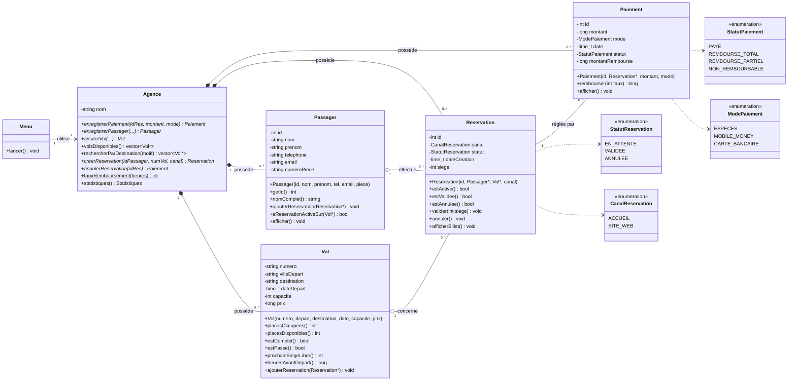
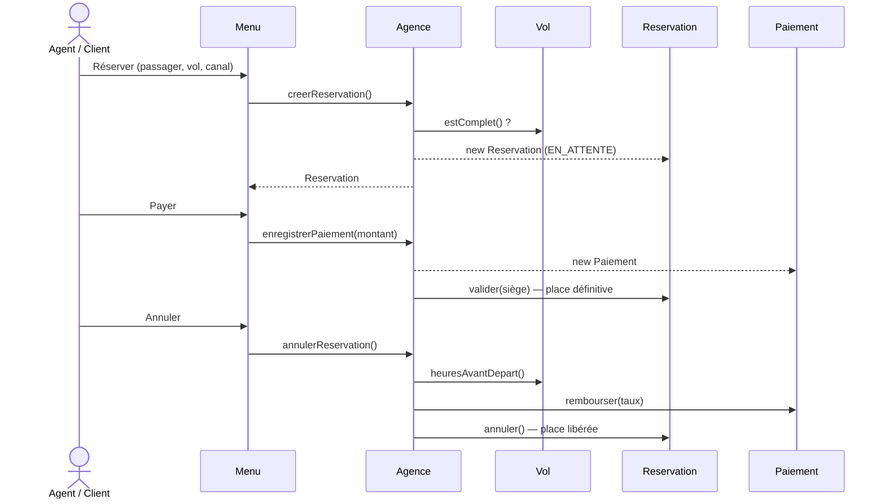
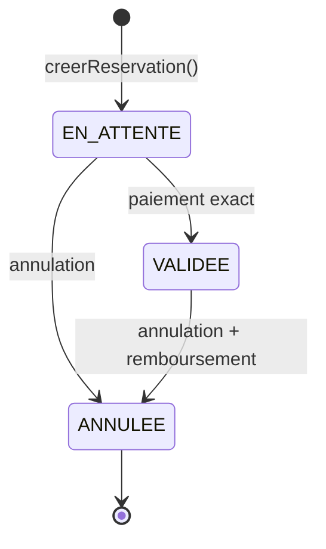

# TP-GESTION-DE-VOLS-
# ✈️ Gestion des vols et réservations — Agence de voyage de Cotonou

> **Matière :** Programmation Orientée Objet (POO) — **Langage :** C++17 — **Modélisation :** UML (PlantUML)
> **Auteur :** _CHABI OROU Achéti Ashfaq_ — **Filière / Classe :** _MIA3_ — **Année :** 2026

---

## 📑 Sommaire

1. [Présentation du projet](#1-présentation-du-projet)
2. [Énoncé](#2-énoncé)
3. [Règles de gestion et leur implémentation](#3-règles-de-gestion-et-leur-implémentation)
4. [Analyse et modélisation UML](#4-analyse-et-modélisation-uml)
   - [4.1 Identification des classes](#41-identification-des-classes)
   - [4.2 Attributs et méthodes](#42-attributs-et-méthodes)
   - [4.3 Associations et multiplicités](#43-associations-et-multiplicités)
   - [4.4 Diagramme de cas d'utilisation](#44-diagramme-de-cas-dutilisation)
   - [4.5 Diagramme de classes](#45-diagramme-de-classes)
   - [4.6 Diagramme de séquence](#46-diagramme-de-séquence)
   - [4.7 Diagramme d'états](#47-diagramme-détats)
5. [Implémentation en C++](#5-implémentation-en-c)
6. [Politique d'annulation et de remboursement](#6-politique-dannulation-et-de-remboursement)
7. [Fonctionnalités supplémentaires](#7-fonctionnalités-supplémentaires)
8. [Compilation et exécution](#8-compilation-et-exécution)
9. [Exemple d'utilisation](#9-exemple-dutilisation)
10. [Structure du dépôt](#10-structure-du-dépôt)
11. [Hypothèses et améliorations possibles](#11-hypothèses-et-améliorations-possibles)

---

## 1. Présentation du projet

Application **console** en C++ qui informatise la gestion des **vols**, des **passagers**, des **réservations**, des **paiements** et des **annulations** d'une agence de voyage située à **Cotonou** (Bénin). Le projet applique les principes de la POO : encapsulation, constructeurs, accesseurs, associations entre objets et conteneurs `std::vector`.

## 2. Énoncé

Une agence de voyage située à Cotonou souhaite informatiser la gestion de ses vols et de ses réservations de billets d'avion.

**Travail demandé :** concevoir et développer une application console permettant de gérer :

- la gestion des passagers ;
- la gestion des vols ;
- la gestion des réservations ;
- la gestion des paiements et des annulations.

**Fonctionnalités principales attendues :**

| N° | Fonctionnalité |
|----|----------------|
| 1 | Enregistrer un passager |
| 2 | Ajouter un vol |
| 3 | Afficher les vols disponibles |
| 4 | Rechercher un vol |
| 5 | Gérer les réservations |
| 6 | Enregistrer un paiement |
| 7 | Annuler une réservation |

**Modélisation UML demandée :** identifier les classes, leurs attributs et méthodes, déterminer les associations et les multiplicités, puis réaliser le diagramme de classes avec PlantUML.

## 3. Règles de gestion et leur implémentation

| # | Règle de l'énoncé | Où / comment elle est appliquée |
|---|-------------------|----------------------------------|
| R1 | Un passager doit être enregistré avant de réserver | `Agence::creerReservation()` refuse un identifiant inconnu |
| R2 | Un vol ne peut pas dépasser sa capacité | `Vol::estComplet()` + contrôle dans `creerReservation()` et `Vol::ajouterReservation()` |
| R3 | Un passager ne réserve pas deux fois le même vol | `Passager::aReservationActiveSur(vol)` |
| R4 | Une réservation = 1 passager + 1 vol | Le constructeur de `Reservation` exige deux pointeurs non nuls |
| R5 | Une réservation annulée ne peut plus être payée | `Agence::enregistrerPaiement()` lève une exception si `estAnnulee()` |
| R6 | Une place n'est définitive qu'après validation | Statut `EN_ATTENTE` → `VALIDEE` (via paiement) ; le siège n'est attribué qu'à la validation |
| R7 | Réservation payée puis annulée → traitée selon le statut de remboursement | `Agence::annulerReservation()` + `Paiement::rembourser(taux)` (voir §6) |

## 4. Analyse et modélisation UML

### 4.1 Identification des classes

| Classe | Rôle |
|--------|------|
| `Passager` | Client enregistré (identité, contacts, pièce d'identité) |
| `Vol` | Vol au départ de Cotonou : destination, date, capacité, prix |
| `Reservation` | Lien entre **un** passager et **un** vol, avec un statut |
| `Paiement` | Règlement d'une réservation et statut de remboursement |
| `Agence` | Classe de gestion : possède les objets et applique les règles |
| `Menu` | Interface console (saisies, affichages, erreurs) |
| _Énumérations_ | `StatutReservation`, `StatutPaiement`, `CanalReservation`, `ModePaiement` |

### 4.2 Attributs et méthodes

Les attributs et méthodes complets figurent dans le diagramme de classes (§4.5) et dans les fichiers `include/*.h`. Tous les attributs sont **privés** (encapsulation) ; l'accès se fait par accesseurs (`getXxx()`).

### 4.3 Associations et multiplicités

| Association | Multiplicités | Type | Justification |
|-------------|---------------|------|---------------|
| `Agence` — `Passager` | 1 — 0..* | Composition | L'agence possède et détruit ses passagers |
| `Agence` — `Vol` | 1 — 0..* | Composition | Idem |
| `Agence` — `Reservation` | 1 — 0..* | Composition | Idem |
| `Agence` — `Paiement` | 1 — 0..* | Composition | Idem |
| `Passager` — `Reservation` | 1 — 0..* | Agrégation | Un passager peut avoir plusieurs réservations (sur des vols différents) |
| `Vol` — `Reservation` | 1 — 0..* | Agrégation | Un vol reçoit au plus `capacité` réservations actives |
| `Reservation` — `Paiement` | 1 — 0..1 | Association | Une réservation est payée au plus une fois |
| `Menu` — `Agence` | 1 — 1 | Dépendance / usage | Le menu pilote l'agence |

> Chaque `Reservation` référence **exactement 1** `Passager` et **exactement 1** `Vol` (multiplicité `1` côté Passager et côté Vol).

### 4.4 Diagramme de cas d'utilisation

Fichier PlantUML : [`docs/uml/01_diagramme_cas_utilisation.puml`](docs/uml/01_diagramme_cas_utilisation.puml)


### 4.4 bis Diagramme de cas d'utilisation (fin)

_(La section 4.4 ci-dessus est complète : si le diagramme s'affiche, passez à 4.5.)_

### 4.5 Diagramme de classes

Fichier PlantUML : [`docs/uml/02_diagramme_classes.puml`](docs/uml/02_diagramme_classes.puml)
_(pour obtenir l'image : coller le contenu du fichier sur <https://www.plantuml.com/plantuml> puis exporter en PNG dans `docs/img/`)_



### 4.6 Diagramme de séquence

Fichier PlantUML : [`docs/uml/03_diagramme_sequence_reservation.puml`](docs/uml/03_diagramme_sequence_reservation.puml)



### 4.7 Diagramme d'états

Fichier PlantUML : [`docs/uml/04_diagramme_etats_reservation.puml`](docs/uml/04_diagramme_etats_reservation.puml)



## 5. Implémentation en C++

| Principe POO | Mise en œuvre dans le code |
|--------------|----------------------------|
| **Encapsulation** | Attributs `private`, accès via accesseurs ; états modifiés uniquement par des méthodes métier (`valider()`, `annuler()`, `rembourser()`) |
| **Constructeurs** | Chaque classe a un constructeur avec liste d'initialisation et **validation** (exceptions `std::invalid_argument`) |
| **Accesseurs / méthodes** | `getXxx()`, `estComplet()`, `placesDisponibles()`, `aReservationActiveSur()`… |
| **Associations** | `Reservation` ↔ `Passager` / `Vol` / `Paiement` par pointeurs ; `Vol` et `Passager` conservent leurs réservations |
| **Composition** | `Agence` possède ses objets via `std::vector<std::unique_ptr<…>>` (adresses stables, pas de fuite mémoire) |
| **Conteneurs** | `std::vector` pour passagers, vols, réservations, paiements et résultats de recherche |
| **Gestion des erreurs** | Exceptions pour les règles métier ; fonctions `lireEntier()`, `lireTexte()`, `confirmer()` qui **redemandent** en cas de saisie invalide (aucun plantage) |
| **Séparation des responsabilités** | `Agence` = logique métier ; `Menu` = interface ; `Utils.h` = saisies/dates |

## 6. Politique d'annulation et de remboursement

Le remboursement dépend du délai restant avant le départ (statut de remboursement prévu par l'application) :

| Annulation… | Taux | Statut du paiement |
|-------------|------|--------------------|
| ≥ 72 h avant le départ | 100 % | `REMBOURSE_TOTAL` |
| entre 24 h et 72 h | 50 % | `REMBOURSE_PARTIEL` |
| < 24 h | 0 % | `NON_REMBOURSABLE` |
| Réservation non payée | — | Aucun paiement à traiter, la place est libérée |

Dans tous les cas, la réservation passe à `ANNULEE`, son siège est libéré et **aucun paiement n'est plus possible** dessus.

## 7. Fonctionnalités supplémentaires

Pour aller au-delà du cahier des charges :

- 🌐 **Canal de réservation** : chaque réservation est faite **à l'accueil** ou **sur le site web**.
- 🎟️ **Attribution automatique du siège** à la validation, et **billet** affichable.
- 💸 **Politique de remboursement graduée** (100 % / 50 % / 0 %).
- 💳 **Plusieurs modes de paiement** : espèces, Mobile Money, carte bancaire (adapté au contexte béninois), montants en **FCFA**.
- 🔍 **Recherche multicritères** : destination (partielle), date, numéro de vol.
- 📊 **Statistiques** : réservations par statut, encaissements, remboursements, recette nette.
- 🧪 **Données de démonstration** (option 11) pour tester rapidement.
- ✅ **Validations avancées** : e-mail, téléphone, dates réelles (rejette le 31/02), pièce d'identité unique.

## 8. Compilation et exécution

**Prérequis :** `g++` (C++17) et `make`.

```bash
git clone <url-du-depot>
cd gestion-vols-cotonou
make
./gestion_vols          # sous Windows : gestion_vols.exe
```

Sans `make` :

```bash
g++ -std=c++17 -Iinclude src/*.cpp -o gestion_vols
```

## 9. Exemple d'utilisation

```
==================================================
  AGENCE COTONOU VOYAGES - GESTION DES VOLS
==================================================
  1. Enregistrer un passager
  2. Ajouter un vol
  3. Afficher les vols disponibles
  4. Rechercher un vol
  5. Reservations
  6. Enregistrer un paiement
  7. Annuler une reservation
  ...
```

**Scénarios testés :**

| Scénario | Résultat obtenu |
|----------|-----------------|
| Réserver pour un passager inexistant | `Passager non enregistre...` |
| Réserver deux fois le même vol | `Ce passager a deja une reservation sur ce vol.` |
| Réserver sur un vol complet | `Vol complet : plus aucune place disponible.` |
| Payer un montant incorrect | `Montant incorrect : il faut regler exactement 450 000 FCFA.` |
| Payer une réservation annulée | `Reservation annulee : paiement impossible.` |
| Annuler une réservation payée à 10 jours du départ | `REMBOURSE TOTALEMENT — 450 000 FCFA` |
| Annuler une réservation payée à 12 h du départ | `NON REMBOURSABLE — 0 FCFA` |
| Saisie `abc` à la place d'un nombre | `Veuillez saisir un nombre entier valide.` (redemande) |
| Date `31/02/2030` | `Date ou heure invalide` |

**Exemple de billet généré après paiement :**

```
  +------------------------------------------------+
  |            BILLET D'AVION - AGENCE COTONOU     |
  +------------------------------------------------+
   Reservation : #1   (ACCUEIL (agence))
   Passager    : Koffi Adjovi (piece BJ-PASS-001)
   Vol         : BJ101  Cotonou -> Paris
   Siege       : 1
   Statut      : VALIDEE
  +------------------------------------------------+
```

## 10. Structure du dépôt

```
gestion-vols-cotonou/
├── README.md
├── Makefile
├── .gitignore
├── docs/
│   └── uml/
│       ├── 01_diagramme_cas_utilisation.puml
│       ├── 02_diagramme_classes.puml
│       ├── 03_diagramme_sequence_reservation.puml
│       └── 04_diagramme_etats_reservation.puml
├── include/
│   ├── Types.h        (énumérations)
│   ├── Utils.h        (saisies sécurisées, dates, validations)
│   ├── Passager.h
│   ├── Vol.h
│   ├── Reservation.h
│   ├── Paiement.h
│   ├── Agence.h
│   └── Menu.h
└── src/
    ├── main.cpp
    ├── Passager.cpp
    ├── Vol.cpp
    ├── Reservation.cpp
    ├── Paiement.cpp
    ├── Agence.cpp
    └── Menu.cpp
```

## 11. Hypothèses et améliorations possibles

**Hypothèses retenues :**

- Une réservation `EN_ATTENTE` **compte dans la capacité** (pas de surréservation) mais la place n'est **définitive qu'une fois validée** par le paiement.
- Le paiement est **intégral** et valide automatiquement la réservation.
- Un passager peut re-réserver un vol **seulement si** sa précédente réservation est annulée.
- Tous les vols partent de **Cotonou**.

**Améliorations possibles :** sauvegarde dans des fichiers (persistance), expiration automatique des réservations en attente, plusieurs classes de voyage, paiement en plusieurs tranches, interface graphique.


