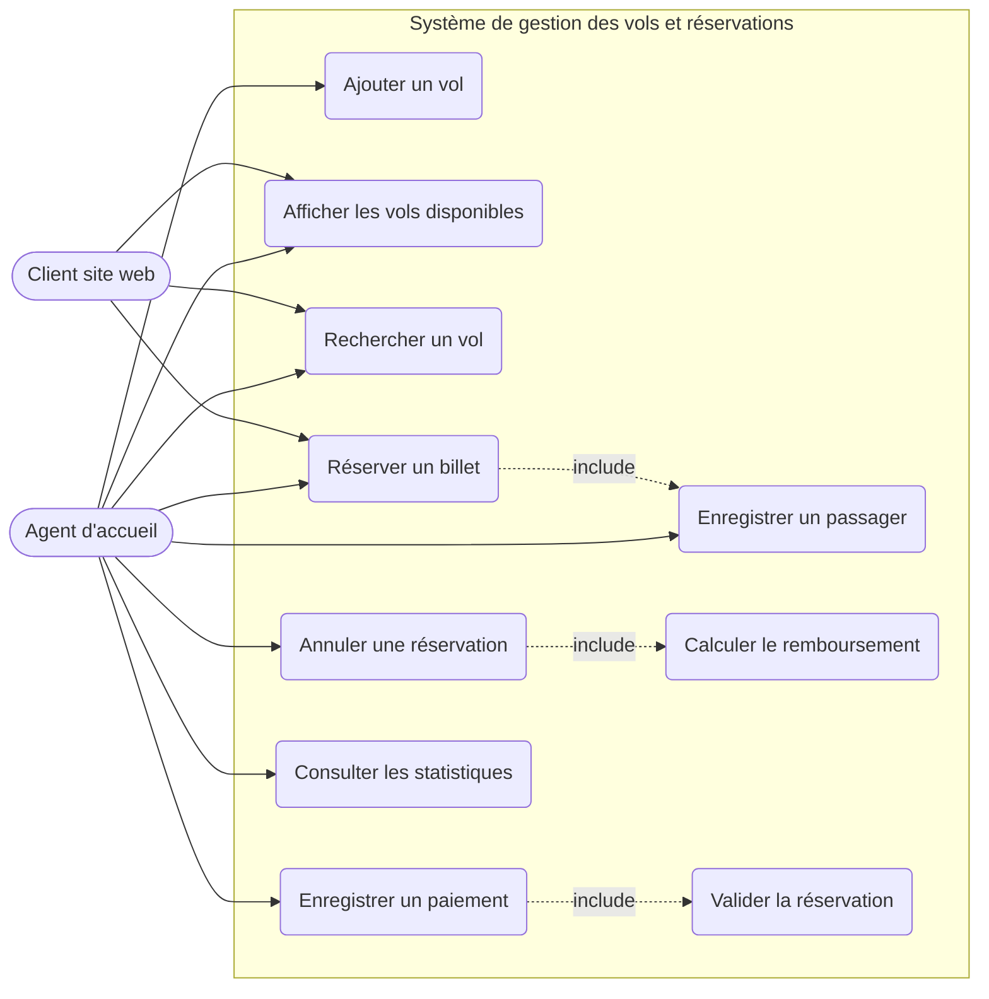

# TP-GESTION-DE-VOLS-
# ✈️ Gestion des vols et réservations — Agence de voyage de Cotonou

> **Matière :** Programmation Orientée Objet (POO) — **Langage :** C++17 — **Modélisation :** UML (PlantUML)
> **Auteur :** _CHABI OROU Achéti Ashfaq_ — **Filière / Classe :** _MIA3_ — **Année :** 2026

---

## 📑 Sommaire

1. [Présentation du projet](#1-présentation-du-projet)
2. [Énoncé](#2-énoncé)
3. [Règles de gestion et leur implémentation](#3-règles-de-gestion-et-leur-implémentation)
4. [Analyse et modélisation UML](#4-analyse-et-modélisation-uml)
   - [4.1 Identification des classes](#41-identification-des-classes)
   - [4.2 Attributs et méthodes](#42-attributs-et-méthodes)
   - [4.3 Associations et multiplicités](#43-associations-et-multiplicités)
   - [4.4 Diagramme de cas d'utilisation](#44-diagramme-de-cas-dutilisation)
   - [4.5 Diagramme de classes](#45-diagramme-de-classes)
   - [4.6 Diagramme de séquence](#46-diagramme-de-séquence)
   - [4.7 Diagramme d'états](#47-diagramme-détats)
5. [Implémentation en C++](#5-implémentation-en-c)
6. [Politique d'annulation et de remboursement](#6-politique-dannulation-et-de-remboursement)
7. [Fonctionnalités supplémentaires](#7-fonctionnalités-supplémentaires)
8. [Compilation et exécution](#8-compilation-et-exécution)
9. [Exemple d'utilisation](#9-exemple-dutilisation)
10. [Structure du dépôt](#10-structure-du-dépôt)
11. [Hypothèses et améliorations possibles](#11-hypothèses-et-améliorations-possibles)

---

## 1. Présentation du projet

Application **console** en C++ qui informatise la gestion des **vols**, des **passagers**, des **réservations**, des **paiements** et des **annulations** d'une agence de voyage située à **Cotonou** (Bénin). Le projet applique les principes de la POO : encapsulation, constructeurs, accesseurs, associations entre objets et conteneurs `std::vector`.

## 2. Énoncé

Une agence de voyage située à Cotonou souhaite informatiser la gestion de ses vols et de ses réservations de billets d'avion.

**Travail demandé :** concevoir et développer une application console permettant de gérer :

- la gestion des passagers ;
- la gestion des vols ;
- la gestion des réservations ;
- la gestion des paiements et des annulations.

**Fonctionnalités principales attendues :**

| N° | Fonctionnalité |
|----|----------------|
| 1 | Enregistrer un passager |
| 2 | Ajouter un vol |
| 3 | Afficher les vols disponibles |
| 4 | Rechercher un vol |
| 5 | Gérer les réservations |
| 6 | Enregistrer un paiement |
| 7 | Annuler une réservation |

**Modélisation UML demandée :** identifier les classes, leurs attributs et méthodes, déterminer les associations et les multiplicités, puis réaliser le diagramme de classes avec PlantUML.

## 3. Règles de gestion et leur implémentation

| # | Règle de l'énoncé | Où / comment elle est appliquée |
|---|-------------------|----------------------------------|
| R1 | Un passager doit être enregistré avant de réserver | `Agence::creerReservation()` refuse un identifiant inconnu |
| R2 | Un vol ne peut pas dépasser sa capacité | `Vol::estComplet()` + contrôle dans `creerReservation()` et `Vol::ajouterReservation()` |
| R3 | Un passager ne réserve pas deux fois le même vol | `Passager::aReservationActiveSur(vol)` |
| R4 | Une réservation = 1 passager + 1 vol | Le constructeur de `Reservation` exige deux pointeurs non nuls |
| R5 | Une réservation annulée ne peut plus être payée | `Agence::enregistrerPaiement()` lève une exception si `estAnnulee()` |
| R6 | Une place n'est définitive qu'après validation | Statut `EN_ATTENTE` → `VALIDEE` (via paiement) ; le siège n'est attribué qu'à la validation |
| R7 | Réservation payée puis annulée → traitée selon le statut de remboursement | `Agence::annulerReservation()` + `Paiement::rembourser(taux)` (voir §6) |

## 4. Analyse et modélisation UML

### 4.1 Identification des classes

| Classe | Rôle |
|--------|------|
| `Passager` | Client enregistré (identité, contacts, pièce d'identité) |
| `Vol` | Vol au départ de Cotonou : destination, date, capacité, prix |
| `Reservation` | Lien entre **un** passager et **un** vol, avec un statut |
| `Paiement` | Règlement d'une réservation et statut de remboursement |
| `Agence` | Classe de gestion : possède les objets et applique les règles |
| `Menu` | Interface console (saisies, affichages, erreurs) |
| _Énumérations_ | `StatutReservation`, `StatutPaiement`, `CanalReservation`, `ModePaiement` |

### 4.2 Attributs et méthodes

Les attributs et méthodes complets figurent dans le diagramme de classes (§4.5) et dans les fichiers `include/*.h`. Tous les attributs sont **privés** (encapsulation) ; l'accès se fait par accesseurs (`getXxx()`).

### 4.3 Associations et multiplicités

| Association | Multiplicités | Type | Justification |
|-------------|---------------|------|---------------|
| `Agence` — `Passager` | 1 — 0..* | Composition | L'agence possède et détruit ses passagers |
| `Agence` — `Vol` | 1 — 0..* | Composition | Idem |
| `Agence` — `Reservation` | 1 — 0..* | Composition | Idem |
| `Agence` — `Paiement` | 1 — 0..* | Composition | Idem |
| `Passager` — `Reservation` | 1 — 0..* | Agrégation | Un passager peut avoir plusieurs réservations (sur des vols différents) |
| `Vol` — `Reservation` | 1 — 0..* | Agrégation | Un vol reçoit au plus `capacité` réservations actives |
| `Reservation` — `Paiement` | 1 — 0..1 | Association | Une réservation est payée au plus une fois |
| `Menu` — `Agence` | 1 — 1 | Dépendance / usage | Le menu pilote l'agence |

> Chaque `Reservation` référence **exactement 1** `Passager` et **exactement 1** `Vol` (multiplicité `1` côté Passager et côté Vol).

### 4.4 Diagramme de cas d'utilisation

Fichier PlantUML : [`docs/uml/01_diagramme_cas_utilisation.puml`](docs/uml/01_diagramme_cas_utilisation.puml)

### 4.5 Diagram
